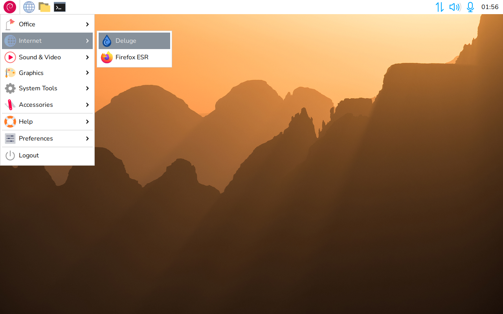
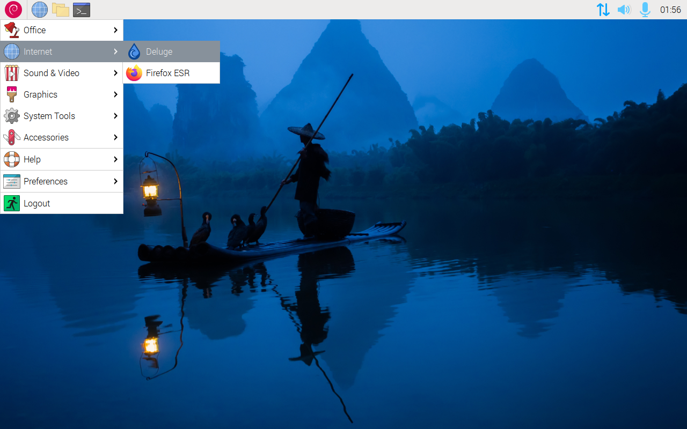
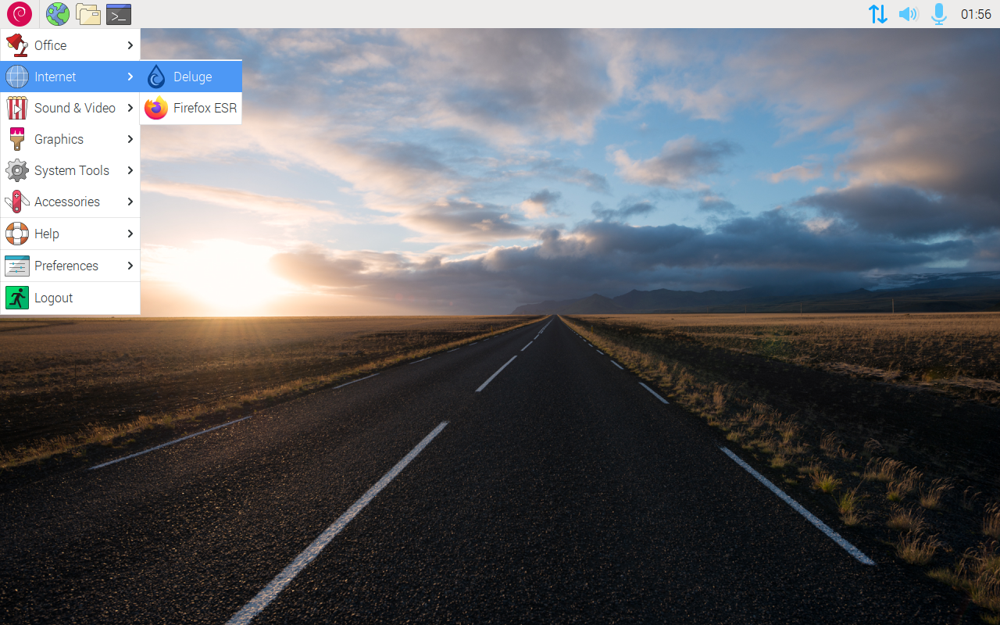
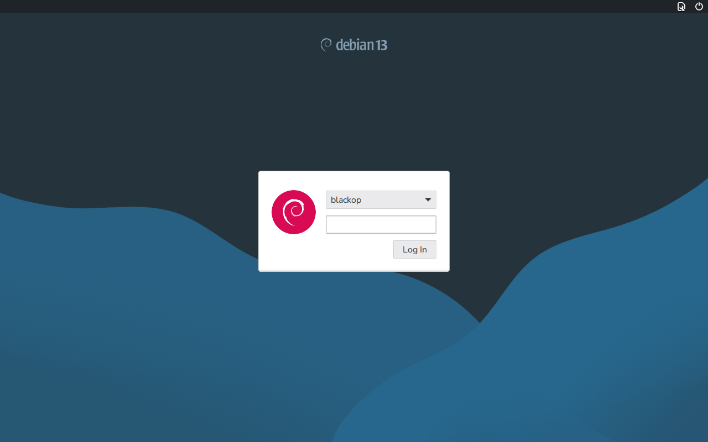

# rpios-look

rpios-look installs the official Raspberry Pi OS desktop on Debian's LXDE
for 32-bit (`i386`) and 64-bit (`amd64`) PCs: Raspberry Pi's themes, icons,
cursors, fonts, wallpapers, panel, file manager and login screen style. It
adds a separate X session, **Raspberry Pi Desktop**, beside Debian's LXDE
session, which is not changed.






## Contents

1. [Quick start](#quick-start)
2. [Modes and options](#modes-and-options)
3. [Changing the look: rpios-look-set](#changing-the-look-rpios-look-set)
4. [Screen lock and power: rpios-look-power](#screen-lock-and-power-rpios-look-power)
5. [Offline installation](#offline-installation)
6. [Updating, upgrading and uninstalling](#updating-upgrading-and-uninstalling)
7. [Supported systems](#supported-systems)
8. [Troubleshooting](#troubleshooting)
9. [How it works](#how-it-works)
10. [Tests](#tests)
11. [Credits and licence](#credits-and-licence)

## Quick start

**Requirements:** Debian 10 or later with Debian's LXDE desktop
(`task-lxde-desktop`); bash 4.4 or later; a normal user account with sudo
rights (do not run the script as root); internet access, except for an
[offline installation](#offline-installation).

1. Download `rpios-look.sh`, or clone this repository:

   ```bash
   git clone https://github.com/b1ack0p/rpios-look.git
   cd rpios-look
   ```

2. Install:

   ```bash
   bash rpios-look.sh
   ```

3. Enter your password, review the plan (every package with its version and
   origin) and answer `y`.
4. Log out. **Raspberry Pi Desktop** is preselected on the login screen; log in.

Every command is safe to run again. Run from a terminal inside the session,
it also refreshes the running desktop.

## Modes and options

Run the script from its folder. Each command below is complete; copy it as
it is. Give one mode at a time.

- `bash rpios-look.sh`:
  Install, or reinstall cleanly. Your Raspberry Pi Desktop settings go back
  to the defaults: theme, wallpaper, panel, power and sleep, size.
- `bash rpios-look.sh --refresh`:
  Update: list the available updates, then ask before applying them.
  Your settings are kept.
- `bash rpios-look.sh --uninstall`:
  Remove what the script added and restore Debian's setup. Your settings
  from before the installation are restored.
- `bash rpios-look.sh --prepare-upgrade`:
  Prepare for a Debian release upgrade (see
  [Upgrade Debian](#updating-upgrading-and-uninstalling)). Settings kept.
- `bash rpios-look.sh --download`:
  Build or refresh `packages/` for an offline installation. Settings not
  touched.
- `bash rpios-look.sh --offline`:
  Install from `packages/`, without a network. Settings back to the
  defaults.
- `bash rpios-look.sh --help`:
  Show the help.
- `bash rpios-look.sh --version`:
  Print the version.

Options, added to a mode above:

- `bash rpios-look.sh --size large`:
  Raspberry Pi OS's size preset for fonts, icons, panel and cursor:
  `small`, `medium`, `large` or `larger` (default: `medium`). It is saved
  and reused by `--refresh`; a plain run goes back to `medium`, as every
  other setting goes back to its default.
- `bash rpios-look.sh --refresh --verbose`:
  Also print the commands run as root, the files downloaded and other
  details; `-v` for short (default: off).

Options combine with a mode in one command, in any order, and
`--size=large` works as well as `--size large`:

```bash
bash rpios-look.sh --refresh --size large --verbose
bash rpios-look.sh --offline --size small
```

Every theme is installed; the default theme matches your Debian release (see
[Themes](#themes)). To change it, use `rpios-look-set`.

## Changing the look: rpios-look-set

`rpios-look-set` changes the Raspberry Pi Desktop session for you only. It
needs no sudo, applies at once (within about a second) and is kept for later
logins.

| Command                               | What it does                          |
|---------------------------------------|---------------------------------------|
| `rpios-look-set --theme pixflat`      | Light theme of Raspberry Pi OS 10-12  |
| `rpios-look-set --theme pixnoir`      | Dark theme of Raspberry Pi OS 12      |
| `rpios-look-set --theme pixtrix`      | Light theme of Raspberry Pi OS 13     |
| `rpios-look-set --theme pixonyx`      | Dark theme of Raspberry Pi OS 13      |
| `rpios-look-set --theme pix`          | Legacy Raspbian theme                 |
| `rpios-look-set --animations off`     | Turn animations off                   |
| `rpios-look-set --animations on`      | Turn animations on                    |
| `rpios-look-set --animations default` | Follow the session's default          |
| `rpios-look-set --list`               | List the installed themes             |
| `rpios-look-set --show`               | Show the current look                 |
| `rpios-look-set --reset`              | Back to the session's look            |
| `rpios-look-set --help`               | Show the help                         |

`--theme` and `--animations` go together in one command; `--reset` is
given alone:

```bash
rpios-look-set --theme pixonyx --animations off
```

Defaults:

- Theme: `pixtrix` on Debian 13 and later, `pixflat` on Debian 10 to 12.
- Animations: `on`, as in Raspberry Pi OS.
- `--reset` returns both to these defaults.

A theme brings its own icons, cursor, font, window frames, colours and
wallpaper, as Raspberry Pi OS gives them. A theme with new icons restarts the
panel, so the panel disappears for a moment; the network and running
programs are not affected.

**Wallpapers.** Every Raspberry Pi OS wallpaper set is installed, 4K
included, each in its own folder under `/usr/share/backgrounds/rpios-look`,
named after its package:

| Folder                    | Size   |
|---------------------------|--------|
| `rpd-wallpaper`           | 26 MB  |
| `rpd-wallpaper-4k`        | 95 MB  |
| `rpd-wallpaper-trixie`    | 44 MB  |
| `rpd-wallpaper-trixie-4k` | 100 MB |
| `cantab-wallpaper`        | 28 MB  |

The folders hold links: the files stay where Raspberry Pi OS's packages
install them (`/usr/share/rpd-wallpaper`), so that updates of those packages
keep working. A set that Raspberry Pi OS releases later gets its own folder.
The theme sets the default wallpaper, the one Raspberry Pi OS uses for that
look and release (see [Themes](#themes)); to pick another, right-click the
desktop, choose Desktop Preferences and open one of these folders. The
Cambridge set brings its wallpapers only, not its screensaver.

**Animations.** Openbox draws an outline when a window is minimized or
restored, and GTK applications animate switches, popovers and panels.
`rpios-look-set --animations off` turns both off. Windows that draw their
own title bar (such as Firefox) and applications with their own animations
are not affected.

Raspberry Pi's Appearance Settings also works, where installed (Debian 10 to
12); otherwise use **Customize Look and Feel** in the menu.

The look you set stays when you change other session settings, such as the
default applications in LXSession Configuration. lxsession would otherwise
write back the look the session started with: it reads its settings file
only at login. A small helper in the session puts your look back after such
a write.

## Screen lock and power: rpios-look-power

The session blanks the screen, switches the monitor off, locks the screen
and suspends the computer when idle. It uses Debian's tools: the X server's
blanking, light-locker and systemd-logind. Other screen lockers and power
managers do not start in this session; Debian's LXDE session keeps its own.

`rpios-look-power` changes these for you only. It needs no sudo and applies
at once.

- `rpios-look-power --lock off`:
  Do not lock the screen; `on` locks after the idle time, on waking and
  with the lock keys (default: `on`).
- `rpios-look-power --lock-after 5`:
  Lock after 5 idle minutes (default: `10`).
- `rpios-look-power --blank 15`:
  Blank the screen after 15 idle minutes (default: `10`).
- `rpios-look-power --monitor-off 20`:
  Switch the monitor off after 20 idle minutes (default: `10`).
- `rpios-look-power --sleep-battery 15`:
  Suspend after 15 idle minutes on battery (default: `30`).
- `rpios-look-power --sleep-ac 60`:
  Suspend after 60 idle minutes on mains power (default: `never`).
- `rpios-look-power --lid lock`:
  When the lid closes while you are logged in: `sleep`, `lock` or
  `nothing` (default: `sleep`).
- `rpios-look-power --sleep-ac default`:
  Return one setting to its default; works with every option.
- `rpios-look-power --show`:
  Show your settings and the defaults.
- `rpios-look-power --reset`:
  Return every setting to its default.
- `rpios-look-power --help`:
  Show the help and the defaults.

Notes:

- Minutes may be written `30`, `30m` or `30min`; `0` or `never` turns the
  action off, for example `rpios-look-power --blank never`.
- Several options can go in one command, together with `default` for any
  of them:

  ```bash
  rpios-look-power --sleep-ac 30 --lock-after 5
  rpios-look-power --blank 15 --monitor-off 20 --lock-after 20 --lid lock
  rpios-look-power --sleep-battery default --sleep-ac never
  ```

- The defaults for every user are in `/usr/share/rpios-look/power.conf`.
- A plain `bash rpios-look.sh` returns your settings to the defaults;
  `--refresh` keeps them.
- The screen locks only with the LightDM login manager, which Debian's LXDE
  uses. With another login manager, the session blanks and suspends but does
  not lock.

## Offline installation

1. On a computer with internet access, in the script's folder:

   ```bash
   bash rpios-look.sh --download
   ```

   It builds `packages/` next to the script.
2. Copy `rpios-look.sh` and `packages/` to the offline computer.
3. There, in the same folder:

   ```bash
   bash rpios-look.sh --offline
   ```

- **Releases:** Debian 10 to 12 on `amd64` and `i386`; Debian 13 on `amd64`.
  Debian testing and unstable are not covered, because they change daily.
- **Result:** the same as an online installation, but without Raspberry Pi's
  APT source, so `apt` does not update the look.
- **Integrity:** every file is checked against `packages/SHA256SUMS` first.
- **Uninstall:** also works offline, with `packages/` next to the script.

## Updating, upgrading and uninstalling

**Update** to a newer version of the script or of Raspberry Pi's packages,
keeping your settings:

```bash
bash rpios-look.sh --refresh
```

- **What it checks:** every theme (PiXflat, PiXnoir, PiXtrix, PiXonyx and
  PiX) with its icons, engines, fonts and wallpapers, for your Debian
  release, whichever theme you use; also the other Raspberry Pi packages the
  look installs.
- **New releases:** a package that Raspberry Pi OS releases later for your
  Debian release is added too: a new theme, icon set, cursor set, GTK 2
  engine, font or wallpaper set, as listed by Raspberry Pi OS's own
  `rpd-theme` package or named like its theme packages. A newly released
  theme shows up in Appearance Settings; `rpios-look-set --theme` offers the
  five themes above.
- **What it shows:** the session, the theme, icons and size you use, and the
  Raspberry Pi OS release the packages come from; then every change. It asks
  before applying them (default answer: no).

On an online installation, Debian's own updates also update Raspberry Pi's
packages:

```bash
sudo apt update && sudo apt full-upgrade
```

Running `bash rpios-look.sh` without `--refresh` also updates, but returns
your Raspberry Pi Desktop settings to the defaults.

**Upgrade Debian** to its next release:

1. Prepare. This removes the packages built for the current release,
   restores Debian's panel and file manager, and removes Raspberry Pi's APT
   source; themes, icons, fonts and wallpapers stay:

   ```bash
   bash rpios-look.sh --prepare-upgrade
   ```

2. Upgrade Debian as usual and restart.
3. Install again for the new release:

   ```bash
   bash rpios-look.sh
   ```

**Uninstall:**

```bash
bash rpios-look.sh --uninstall
```

It lists what it removes and asks first. It restores Debian's Openbox, panel
and file manager and your settings; other users keep theirs. After a second
question it removes the packages it installed, hardware support included;
packages you had before, or that other software needs, stay. Restart to
finish.

## Supported systems

| Debian            | PCs            | Panel and file manager    | Default theme |
|-------------------|----------------|---------------------------|---------------|
| 10 (buster)       | 32-bit, 64-bit | Raspberry Pi OS 10 builds | PiXflat       |
| 11 (bullseye)     | 32-bit, 64-bit | Raspberry Pi OS 11 builds | PiXflat       |
| 12 (bookworm)     | 32-bit, 64-bit | Raspberry Pi OS 12 builds | PiXflat       |
| 13 (trixie)       | 64-bit         | Raspberry Pi OS 13        | PiXtrix       |
| testing, unstable | 64-bit         | Raspberry Pi OS 13        | PiXtrix       |

The script runs on Debian itself with Debian's LXDE installed, and stops
before changing anything otherwise. The session runs on X (Openbox) on every
release.

**Network icon.** On Debian 12 and 13, Raspberry Pi's network item is used
when NetworkManager manages the network and Raspberry Pi OS has a matching
build of `libnma`. Otherwise (always on Debian 10 and 11, usually on testing
and unstable), Debian's network icon (nm-applet) appears in the tray.

### What is tested

Every release above, 32-bit and 64-bit where available, from a fresh Debian
LXDE installation, with every theme: online and offline installation,
uninstallation, look, keys, menus, launchers, screen lock, package health
and speed, compared with Raspberry Pi OS and with Debian's own LXDE. The
results are in [tests/HISTORY.md](tests/HISTORY.md).

### Speed and resources

The target is Debian's own LXDE on the same computer. Measured on virtual
machines (2 CPUs, 3 GB, no GPU driver):

| Measure                      | rpios-look      | Debian's LXDE   |
|------------------------------|-----------------|-----------------|
| Login to a ready panel       | 1.3-2.5 s       | 1.7-2.4 s       |
| Idle CPU, per minute         | 10-50 ms        | 30-90 ms        |
| Main menu opens              | 25-51 ms        | 285-378 ms      |
| Terminal, file manager start | within 15%      | (reference)     |
| Session memory, Debian 10/13 | the same        | (reference)     |
| Session memory, Debian 11/12 | 37-74 MB more   | (reference)     |
| Disk                         | 113-178 MB more | (reference)     |

The disk figure is without the 4K wallpapers, which add about 195 MB.

On Debian 11 and 12, Raspberry Pi's panel and file manager are GTK 3
programs (Debian's are GTK 2). GTK 3 loads the OpenGL driver when a program
starts; without a GPU driver that is Mesa's software renderer (llvmpipe),
about 23 MB per program. This is left as it is: turning it off
(`GDK_GL=disable`) would also turn off OpenGL in the programs you start
from the session.

With NVIDIA's own driver the session runs `picom` (no effects) as the
compositor. Without one, that driver draws window corners square while a
window is moved. Other drivers get no compositor, as on Raspberry Pi OS.

## Troubleshooting

- **The look is missing after login.**
  Select *Raspberry Pi Desktop* in the login screen's session menu.
- **The login screen is not styled.**
  The script installs LightDM and styles it when no login manager is set up
  or LightDM is the one in use, as with Debian's LXDE. Another login manager
  (GDM, SDDM, LXDM) is left as it is, without the style. To switch to
  LightDM, choose it when asked:
  `sudo apt install lightdm lightdm-gtk-greeter && sudo dpkg-reconfigure lightdm`,
  then `bash rpios-look.sh --refresh`.
- **"dpkg was interrupted".**
  An earlier installation, by any program, stopped half-way; the script
  checks this before it starts and changes nothing. Finish it with
  `sudo dpkg --configure -a && sudo apt-get -f install`, then run the script
  again.
- **404 Not Found.**
  Your Debian release has moved to archive.debian.org. Update
  `/etc/apt/sources.list` as
  [Debian describes](https://www.debian.org/distrib/archive), run
  `sudo apt update`, then run the script again.
- **Something looks incomplete.**
  `bash rpios-look.sh --refresh`; every step is safe to repeat.
- **The theme looks wrong after a change.**
  `rpios-look-set --reset`, or set the theme again, for example
  `rpios-look-set --theme pixtrix`.
- **Desktop icon labels look soft.**
  As on Raspberry Pi OS, which draws light grey labels over a light shadow
  in a thin font; the values are the same.
- **The microphone is unmuted after logging out and in (Debian 13 and
  later).**
  WirePlumber's behaviour, the same on Raspberry Pi OS 13: the login screen
  starts its own sound service, which resets the sound card, and your
  session saves that state. Mute it again after logging in. Debian 10 to 12
  keep the mute.

Each run writes a log to your home folder, for example
`~/rpios-look-install-<date>-<time>.log`. The ten newest logs of each mode are
kept. For more detail, add `--verbose`, for example
`bash rpios-look.sh --refresh --verbose`.

## How it works

### Themes

All five themes are installed, each with the icons, cursor, font, window
frames and wallpaper that Raspberry Pi OS gives it. Where Raspberry Pi OS
shows its logo (the menu button and the login screen's user picture), every
theme shows the Debian logo: a white swirl on a red circle.

| Theme     | Style                         | Font              |
|-----------|-------------------------------|-------------------|
| `pixflat` | Light; Raspberry Pi OS 10-12  | Piboto Light      |
| `pixnoir` | Dark; Raspberry Pi OS 12      | Piboto Light      |
| `pixtrix` | Light; Raspberry Pi OS 13     | Nunito Sans Light |
| `pixonyx` | Dark; Raspberry Pi OS 13      | Nunito Sans Light |
| `pix`     | Legacy; Raspbian 9            | Piboto Light      |

Default wallpaper of each theme:

- `pixflat`, `pixnoir`: `rpd-wallpaper/temple.jpg` (Debian 10),
  `rpd-wallpaper/clouds.jpg` (11), `rpd-wallpaper/fisherman.jpg` (12 and
  later), as Raspberry Pi OS Buster, Bullseye and Bookworm.
- `pixtrix`, `pixonyx`: `rpd-wallpaper-trixie/sunrise.jpg`, as Raspberry Pi
  OS Trixie.
- `pix`: `rpd-wallpaper/road.jpg`, as Raspbian Stretch.

All are under `/usr/share/backgrounds/rpios-look`.

Qt applications follow the theme through the GTK platform themes.

### Keys and buttons

As on Raspberry Pi OS:

| Key                                   | Action                              |
|---------------------------------------|-------------------------------------|
| **Super**, **Ctrl+Esc**               | Main menu                           |
| **Alt+F2**                            | Run a command                       |
| **Ctrl+Alt+T**                        | Terminal (see below)                |
| **Ctrl+Shift+Esc**                    | Task manager                        |
| **Ctrl+Alt+Delete**, **Ctrl+Alt+End** | Shutdown dialog                     |
| **Print**                             | Screenshot with `scrot`, if present |
| **Ctrl+Alt+Left/Right**               | Window to the left or right half    |
| **Ctrl+Alt+Up/Down**                  | Maximize, restore                   |
| **Ctrl+Alt+D**                        | Show the desktop                    |
| **Alt+F11**                           | Full screen                         |
| **Ctrl+Alt+B**                        | Bluetooth menu                      |
| **Ctrl+Alt+W**                        | Network menu (Raspberry Pi's item)  |
| **Ctrl+Alt+M**                        | Magnifier, once added to the panel  |
| Volume keys                           | Volume, through the panel           |

The terminal is LXTerminal, unless you chose another with
`sudo update-alternatives --config x-terminal-emulator`.

Added for PCs and laptops:

- **Ctrl+Alt+L**, the lock key (Fn+F3 on ThinkPads): lock the screen.
- The wireless key (Fn+F5 on ThinkPads): turn Wi-Fi and Bluetooth off or on
  together. Where the laptop switches Wi-Fi itself, Bluetooth follows.
- The power button: open the shutdown dialog; press again while it is open
  to shut down.

Some older laptops do not report a short press of the power button; on
those, only a long press (forced power-off) works. Outside the session, the
power button and the lid follow Debian's settings.

### Compared with Raspberry Pi OS

**From Raspberry Pi OS:**

- **Themes, icons, cursors, fonts, wallpapers:** `pixflat-theme`,
  `pixtrix-theme`, `pix-theme`, `pixflat-icons`, `pixtrix-icons`,
  `rpd-icons`, `fonts-piboto`, `fonts-nunito-sans`, `rpd-wallpaper*` (4K
  sets included), `cantab-wallpaper`.
- **Panel:** Debian 10 to 12: Raspberry Pi OS builds of `lxpanel` with
  `lxplug-*`. Debian 13: `lxpanel-pi` with `lpplug-*`.
- **File manager and desktop:** Debian 10 to 12: Raspberry Pi OS builds of
  `pcmanfm` and `libfm`. Debian 13: `pcmanfm-pi`.
- **Window manager:** Raspberry Pi OS build of `openbox` (keeps corners
  rounded while moving or resizing).
- **Dialogs and settings:** `pishutdown`, `gui-runcmd`, `pipanel` (Debian
  10 to 12).
- **Magnifier:** `mage` (Debian 10, 11), `mage-rpi` (Debian 12, 13).
- **Panel layout, menu, desktop and window settings:** read from
  `raspberrypi-ui-mods` (Debian 10 to 12) and `rpd-*` (Debian 13); not
  installed.

**From Debian:** the system services (BlueZ, NetworkManager, PipeWire or
PulseAudio, udisks, systemd-logind), the applications, lxsession,
LightDM with Debian's greeter, the screen locker and the authentication
agent. Raspberry Pi OS uses the same Debian programs for these.

**Differences** (here, then on Raspberry Pi OS):

- **Keyboard shortcuts:** Raspberry Pi OS's for each release, without
  Ctrl+Alt+Space (screen reader installer). Raspberry Pi OS: full set.
- **Resizing a window:** contents redraw while dragging. Raspberry Pi OS:
  blank until the mouse is released.
- **Terminal:** Debian's LXTerminal, opened without transparency as
  Raspberry Pi's build is, so every edge resizes it. Raspberry Pi OS 13:
  Raspberry Pi's build of LXTerminal.
- **Double-click on a title bar:** maximizes when the clicks are up to
  400 ms apart, as GTK applications count a double-click. Raspberry Pi OS:
  200 ms, so a slower double-click is missed.
- **Menu button and login logo:** Debian logo. Raspberry Pi OS: Raspberry
  Pi logo.
- **Login screen:** Debian's LightDM greeter in Raspberry Pi OS's style,
  with user list and session menu. Raspberry Pi OS: Raspberry Pi's greeter.
- **File manager on Debian 13:** Raspberry Pi's, alongside Debian's.
  Raspberry Pi OS: Raspberry Pi's only.
- **Network icon:** see [Supported systems](#supported-systems). Raspberry
  Pi OS: Raspberry Pi's.
- **Magnifier:** installed; add it to the panel to use it. Raspberry Pi OS:
  not installed by default.
- **Wallpapers:** every set, 4K and Cambridge included, in folders.
  Raspberry Pi OS: the standard sets of its release, in one folder.
- **Menu on Debian 10 to 12:** an **Other** category with Debian's legacy
  menu entries, where Debian's `menu` package is installed. Raspberry Pi
  OS: no such entries.
- **Shutdown dialog:** no "Press Ctrl-Alt-L to lock screen" line
  (Ctrl+Alt+L still locks). Raspberry Pi OS: shows the line.
- **raspi-config, updater, Raspberry Pi Connect, on-screen keyboard, panel
  power item:** omitted, as they need Raspberry Pi hardware or system tools.
  Raspberry Pi OS: included.
- **Screen lock, suspend, lid, `rpios-look-power`:** included. Raspberry Pi
  OS: blanking only.
- **Menu categories:** for every installed application. Raspberry Pi OS:
  for the applications it ships.
- **`rpios-look-set`:** included. Raspberry Pi OS: not available.

Raspberry Pi's programs are used unchanged, with one fix:

- **Fixed:** the PIN field of the Bluetooth pairing dialog does not accept
  typing (Bluetooth 2.0 devices; all releases). Here the field takes
  keyboard focus.
- **Unchanged:** pairing started from this computer stops after 25 seconds
  (all releases); start pairing from the other device.
- **Unchanged:** ejecting a partition of an internal disk reports "Failed
  to eject", although it is unmounted (Debian 10 to 12).

### What changes on the computer

- **Raspberry Pi Desktop:** a new session.
- **Debian's LXDE:** uses Raspberry Pi OS's Openbox, and on Debian 10 to 12
  its panel and file manager. Its settings, autostart, screen lock and power
  are not changed.
- **Login screen:** LightDM and its greeter are installed where no other
  login manager is in use, and the greeter gets Raspberry Pi OS's style.
  Other login managers are not changed.
- **Packages:** the Raspberry Pi OS packages listed above; the Debian
  packages the session needs, including hardware support (X server,
  network, Bluetooth, sound) where missing. Packages already installed are
  not changed.
- **System files:** Raspberry Pi's APT source, pinned to the look's
  packages, with an APT check (online installations only); a polkit rule
  for suspend. Everything else is not changed.

The polkit rule lets a local session that is not in the foreground (for
example, behind a locked screen) suspend the computer without a password.
polkit cannot distinguish a locked session from one on another virtual
console. The rule covers suspend only, never remote logins.

### Keeping Debian safe

The script follows Debian's
[DontBreakDebian](https://wiki.debian.org/DontBreakDebian) guidance:

- No Debian package is replaced, except Openbox (and, on Debian 10 to 12,
  the panel and file manager) by Raspberry Pi OS's builds.
- Packages that would replace, break or conflict with Debian packages are
  refused, now and on later APT updates.
- Debian packages come only from your own APT sources.
- Archives are verified against their signing keys, and every package
  against its SHA256 checksum.
- The plan lists every package before anything changes.
- Changed settings are backed up; `--uninstall` restores them.

## Tests

The test runs and their results are recorded in
[tests/HISTORY.md](tests/HISTORY.md).

Unit tests of the script's decision helpers need no root or network:

```bash
sudo apt install bats
bats tests/
```

## Credits and licence

The themes, icons, fonts, wallpapers and desktop settings are the work of
[Raspberry Pi Ltd](https://www.raspberrypi.com/) and the Raspberry Pi desktop
team. This project installs their official packages on Debian. All artwork
keeps its own licence (see `/usr/share/doc/<package>/copyright`).

The script is released under the MIT licence; see [LICENSE](LICENSE).
