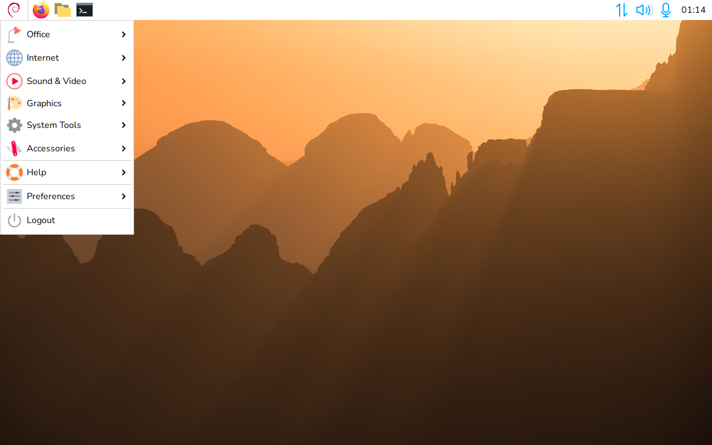
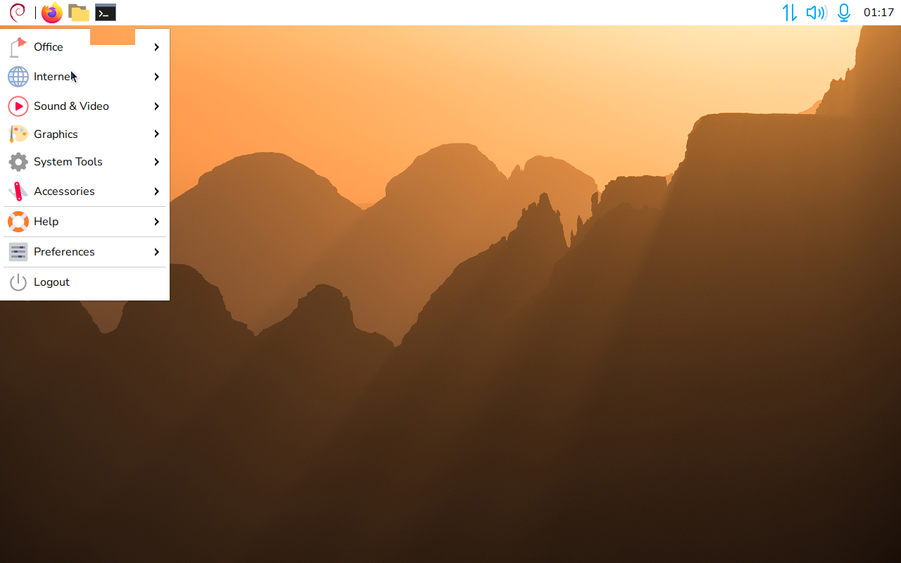
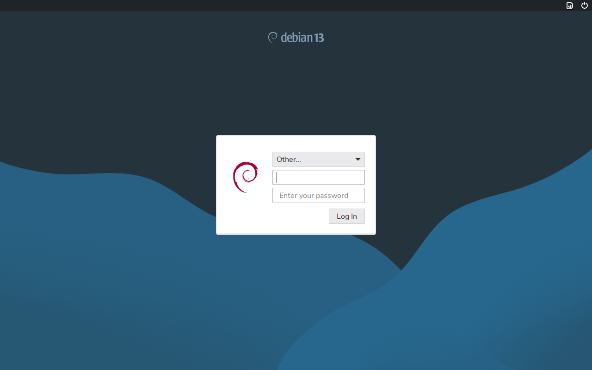
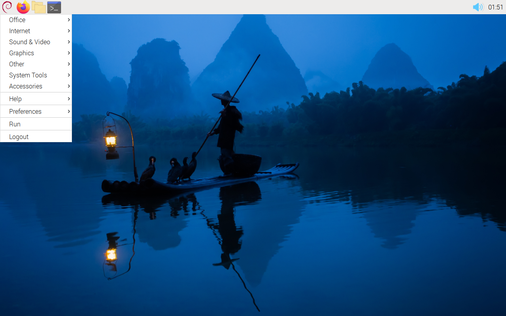

# rpios-look

rpios-look makes Debian look like Raspberry Pi OS, without breaking Debian.
It installs Raspberry Pi OS's official themes, icons, cursors, fonts,
wallpapers, panel, file manager and login screen style as a separate session,
**Raspberry Pi Desktop**, and leaves your settings in Debian's own sessions
unchanged unless you ask for them with
[`--desktop`](#other-desktops).






## Contents

1. [Overview](#overview)
2. [Requirements](#requirements)
3. [Installation](#installation)
4. [Usage](#usage)
5. [Themes](#themes)
6. [Changing the look per user](#changing-the-look-per-user)
7. [X or Wayland](#x-or-wayland)
8. [Panel and file manager](#panel-and-file-manager)
9. [The session](#the-session)
10. [What is installed](#what-is-installed)
11. [Updating, upgrading and uninstalling](#updating-upgrading-and-uninstalling)
12. [Offline installation](#offline-installation)
13. [Troubleshooting](#troubleshooting)
14. [How it works and keeping Debian safe](#how-it-works-and-keeping-debian-safe)
15. [Credits and licence](#credits-and-licence)

## Overview

**Supported systems:** Debian 10 (buster) or later, including testing,
unstable and derivatives, on amd64, arm64, armhf and i386. On other
architectures Raspberry Pi publishes no builds, so only the themes, icons,
fonts and wallpapers are installed: not Raspberry Pi's panel, file manager,
greeter or GTK 2 engines, and no [offline installation](#offline-installation).

All five themes are installed (see [Themes](#themes)). The session runs on
Wayland or X, depending on the computer (see [X or Wayland](#x-or-wayland)).
On Debian 10 to 12, Raspberry Pi OS's panel and file manager replace Debian's
(see [Panel and file manager](#panel-and-file-manager)).

Differences from Raspberry Pi OS:

- **Debian logo.** The Debian logo replaces the Raspberry Pi logo on the menu
  button and the login screen. No program shows the Raspberry Pi logo: the
  Shutdown dialog shows its Shutdown icon on every Debian release, as it does
  on Raspberry Pi OS 13.
- **Tools left out.** Raspberry Pi's system tools are not installed:
  raspi-config and the updater; the panel's power plugin, which reports
  Raspberry Pi power supply problems, only on a Raspberry Pi; on Wayland also
  the Raspberry Pi Connect and on-screen keyboard plugins.
- **Network icon.** On Debian 12 and 13, where NetworkManager runs the
  network, the panel has Raspberry Pi OS's own network plugin, with its
  Wi-Fi menu and connection editor. It needs Raspberry Pi's build of Debian's
  `libnma0` (the same version with Raspberry Pi's patch), which replaces
  Debian's while the look is installed; uninstall puts Debian's back.
  Elsewhere Debian's `nm-applet` shows the network icon in the notification
  area.
- **Window corners.** On X, Debian's Openbox rounds the window corners of
  the themes that Raspberry Pi OS rounds (PiX, PiXflat, PiXnoir) and keeps
  PiXtrix and PiXonyx square; its rounding is 2 pixels, where Raspberry Pi's
  own Openbox build rounds PiXflat and PiXnoir by 1. On Wayland, labwc keeps
  square corners for every theme, as on Raspberry Pi OS.
- **Greeter.** The login screen is Debian's LightDM GTK greeter in Raspberry
  Pi OS's style, with a session chooser. `--pi-greeter` uses Raspberry Pi's
  own greeter, which has none.

## Requirements

- Debian 10 or later, or a derivative, with bash 4.4 or later.
- A normal user account with sudo rights. Do not run the script as root.
- Internet access, except for an [offline installation](#offline-installation).
- About 80 MB of disk space, and about 200 MB more for the 4K wallpapers.

## Installation

1. Download `rpios-look.sh`, or clone this repository.
2. In a terminal, in the script's folder, run:

   ```bash
   bash rpios-look.sh
   ```

3. Review the detected computer, enter your password when asked, review the
   plan (every package with its version and origin) and answer `y`.
4. When the packages are installed, choose a theme. Press Enter to keep the
   default.
5. Log out. **Raspberry Pi Desktop** is selected for you on the login screen.
   Log in.

Running the script again is safe. `-y` answers yes to every question and
skips the theme menu (the saved or default theme is used). Without a
terminal, each question takes its default answer: an install proceeds, but
`--uninstall` and `--prepare-upgrade` stop at their first question and
`--refresh` applies nothing; give `-y` to run these unattended.

## Usage

```bash
bash rpios-look.sh [MODE] [OPTION]...
```

| Mode | Action |
|------|--------|
| *(none)* | Install, or update an existing install |
| `--refresh` | List available updates, then ask to apply them |
| `--uninstall` | Remove everything this script added and restore Debian's default setup (see [Uninstalling](#uninstalling)) |
| `--prepare-upgrade` | Prepare for a Debian release upgrade (see [Upgrading Debian](#upgrading-debian)) |
| `--download` | Build `packages/` for an [offline installation](#offline-installation) |
| `--offline` | Install from `packages/` |

An install run saves the following options; later runs reuse them unless
they are given again (for example `--theme auto`). They are reused only while
the look is installed: a fresh install detects the computer again.

| Remembered option | Description | Default |
|-------------------|-------------|---------|
| `-t`, `--theme NAME` | `pixflat`, `pixnoir`, `pixtrix`, `pixonyx`, `pix` or `auto` (see [Themes](#themes)) | Asked at the end; `auto` |
| `--4k`, `--no-4k` | The 4K wallpapers, or the standard ones | Off |
| `--wayland`, `--no-wayland`, `--auto` | The display system (see [X or Wayland](#x-or-wayland)) | `--auto` |
| `--pi-apps`, `--no-pi-apps` | Raspberry Pi's panel and file manager, or Debian's (see [Panel and file manager](#panel-and-file-manager)) | On |
| `--login-screen`, `--no-login-screen` | The Raspberry Pi OS login screen style (see [Login screen](#login-screen)) | On |
| `--pi-greeter`, `--no-pi-greeter` | Raspberry Pi's own greeter, which has no session chooser | Off |
| `--login-background B` | `debian` (Debian's login artwork), `raspios`, or the absolute path of a picture, using only `A-Z a-z 0-9 . _ / + -` and without `..` | `debian` |
| `--qt`, `--no-qt` | Qt applications follow the GTK theme in the session | Off |
| `--size SIZE` | Raspberry Pi OS's size presets (Appearance Settings, Defaults) for the font, panel icons and height, taskbar buttons, toolbar and file manager icons, cursor and terminal font: `small`, `medium` (Raspberry Pi OS's default), `large` or `larger`. | `medium` |

| One-run option | Description |
|----------------|-------------|
| `-d`, `--desktop LIST` | Also give other desktops the look, for you only (see [Other desktops](#other-desktops)). A comma-separated list of `lxde`, `openbox`, `labwc`, `xfce`, `mate`; or `all` or `none` (default). |
| `--bundle LIST` | With `--download`: only these comma-separated release/architecture pairs, for example `bookworm/i386,trixie/amd64` |
| `-y`, `--yes` | Answer yes to every question |
| `-v`, `--verbose` | Print the commands run with sudo, the download URLs and other details |
| `--no-log` | Do not write a [log file](#troubleshooting) |
| `-h`, `--help` | Show the help |
| `-V`, `--version` | Show the version |

## Themes

| Theme | Style | Font | Wallpaper |
|-------|-------|------|-----------|
| `pixflat` | Light, Raspberry Pi OS Buster to Bookworm; default on Debian 10 to 12 | Piboto Light | temple on Debian 10, clouds on 11, fisherman on 12 and later |
| `pixnoir` | Dark, Raspberry Pi OS Bookworm | Piboto Light | as `pixflat` |
| `pixtrix` | Light, Raspberry Pi OS Trixie; default on Debian 13 and later | Nunito Sans Light | sunrise |
| `pixonyx` | Dark, Raspberry Pi OS Trixie | Nunito Sans Light | sunrise |
| `pix` | Legacy, Raspbian Stretch | Piboto Light | road |

Each theme comes with its own icons, cursor, window frames and colours, and
the wallpaper Raspberry Pi OS uses with it in that release.

The installer asks for the theme at the end. `--theme` sets it without
asking, as the default for all users; `auto` is the default for your Debian
release:

```bash
bash rpios-look.sh --theme pixonyx
bash rpios-look.sh --theme auto
```

If you have your own settings in the session, the chosen theme is applied to
them too. Other users who chose their own theme with
[`rpios-look-set`](#rpios-look-set) keep it.

## Changing the look per user

These change the look for the current user only. Changes apply at once and
are kept for later logins.

| Session | Tool | Themes |
|---------|------|--------|
| X | **Preferences > Customize Look and Feel** | All installed themes |
| Wayland | **Preferences > Control Centre** | Light (PiXtrix) or Dark (PiXonyx), as on Raspberry Pi OS 13 |
| Both | `rpios-look-set` (command line) | All installed themes |

The Control Centre is Raspberry Pi OS 13's own (`rpcc`, with its Appearance
Settings, `pipanel`). It is installed with the Wayland session.

### rpios-look-set

`rpios-look-set` needs no sudo.

| Option | Action |
|--------|--------|
| `--theme NAME` | Use `pixflat`, `pixnoir`, `pixtrix`, `pixonyx` or `pix` |
| `--list` | Show the installed themes |
| `--show` | Show the current look |
| `--reset` | Return to the session's look, as installed |
| `-h`, `--help` | Show the help |

`--theme` sets everything Raspberry Pi OS gives the theme: its icons, its
cursor (24 pixels), its font (size 12, in applications, on the desktop and in
window titles), its window frames and colours, and its wallpaper for your
Debian release, cropped to the screen. The settings apply to both sessions,
X and Wayland.

```bash
rpios-look-set --theme pixonyx
rpios-look-set --reset
```

## X or Wayland

The script detects the computer before installing (model, processor, memory,
graphics and driver, 3D acceleration, virtual machine, kernel, Debian
release, desktops and login manager) and, following Raspberry Pi OS, selects
**Wayland (labwc)** or **X (Openbox)**:

- Wayland needs Debian 13 or later and graphics with kernel modesetting.
- Every Raspberry Pi gets Wayland, as on Raspberry Pi OS.
- Other computers get Wayland with at least 2 GB of memory, a 64-bit system,
  a PC processor with SSE4.2, and 3D acceleration with a tested driver:
  Intel (`i915`, `xe`), AMD (`amdgpu`), ARM graphics (`vc4`, `v3d`, `msm`,
  `panfrost`, `panthor`, `lima`, `etnaviv`, `rockchip`, `mediatek-drm`,
  `meson`, `sun4i-drm`, `imx-drm`) or virtual machines with 3D
  (`virtio_gpu`, `vmwgfx`).
- All other cases get X: Debian 10 to 12, no kernel modesetting, less memory,
  32-bit systems, older processors, no 3D acceleration, older AMD graphics
  (`radeon`), NVIDIA graphics (`nvidia`, `nouveau`) and untested drivers.
- If labwc or Raspberry Pi's Wayland panel (`wf-panel-pi`) is not available
  for your release and architecture, the session runs on X.

X is always installed, because the login screen runs on it, and the X
session is always available. To change the choice:

```bash
bash rpios-look.sh --wayland        # use Wayland
bash rpios-look.sh --no-wayland     # use X only
bash rpios-look.sh --auto           # let the script decide again
```

`--wayland` cannot override the Debian release, missing kernel modesetting or
missing Wayland packages. Your next login uses the new choice; to switch for
one login only, choose the session on the login screen.

As on Raspberry Pi OS, windows have rounded corners on X and square corners
on Wayland. Tooltips are square on X from Debian 11, and rounded on Wayland
and on Debian 10.

### NVIDIA graphics

Wayland with NVIDIA's own driver needs kernel modesetting, which Debian
leaves off. To enable it:

```bash
printf 'options nvidia-drm modeset=1\noptions nvidia-current-drm modeset=1\n' \
  | sudo tee /etc/modprobe.d/nvidia-modeset.conf
sudo update-initramfs -u
sudo reboot
```

Then run `bash rpios-look.sh --wayland`. Wayland on NVIDIA can show minor
display glitches; `--no-wayland` returns to X.

## Panel and file manager

### Debian 10 to 12

Before Raspberry Pi OS 13, Raspberry Pi's panel and file manager are its own
builds of Debian's `lxpanel`, `pcmanfm` and `libfm`, under the same names.
From Raspberry Pi OS 11 they use GTK 3, while Debian 11 and 12 build theirs
and their plugins for GTK 2, so the two cannot be mixed. With `--pi-apps`
(the default), the script installs Raspberry Pi OS's builds for your release
in place of Debian's, with Raspberry Pi's panel plugins (`lxplug-*`), and
Debian's LXDE session then uses them too. The plan names them before
anything changes.

- `--no-pi-apps` keeps Debian's panel and file manager, in Raspberry Pi OS's
  layout.
- If Raspberry Pi has no build of an installed package of these sources (for
  example a `-dbg` package), Debian's are kept.
- `--uninstall` and `--prepare-upgrade` install Debian's versions again.
- On Debian 11 and 12, Raspberry Pi's GTK 3 panel cannot draw Debian's LXDE
  panel layout: it has no pager or background image, and its menu plugin is
  called `smenu`. While the look is installed, Debian's LXDE session reads an
  adapted copy of Debian's layout from the session package (no pager, the
  theme's panel colour, the menu as `smenu`). Debian's files and your own
  panel settings are not changed; a panel layout you saved yourself in
  `~/.config/lxpanel/LXDE` is used as it is.

On Debian 13 and later, Raspberry Pi's panel (`lxpanel-pi`) and file manager
(`pcmanfm-pi`) are installed beside Debian's, which stay unchanged.

### Layout

The panel is Raspberry Pi OS's own layout for your Debian release, with its
spaces and separators: menu, launchers, taskbar, eject, Bluetooth, network,
volume, clock and battery. Differences:

- Where Debian's `nm-applet` is used (see [Overview](#overview)), the
  notification area takes the network plugin's place.
- The **keyboard layout** applet (`xkb`) is installed but, as on Raspberry Pi
  OS, not on the panel; add it with **Add / Remove Panel Items**.
- The **magnifier** (`mage-rpi`) is installed and opens with Ctrl+Alt+M. Its
  panel plugin is installed but not on the panel, which by default shows no
  magnifier on Raspberry Pi OS, where the magnifier is optional.
- The **battery** appears only on a computer with a battery.
- The **microphone** and **Bluetooth** icons appear only when the computer
  has a microphone or a Bluetooth adapter, as on Raspberry Pi OS. Turned off,
  Bluetooth shows a grey icon, as on Raspberry Pi OS, also on laptops whose
  own Bluetooth switch would power the adapter off (ThinkPads and others):
  there the switch stays on and only the adapter's radio is turned off, and
  the session package's `rfkill` (Debian's diverted to `rfkill.distrib`)
  lists the adapter first, as the panel's plugin reads only the first entry.
- **Pop-ups** of the panel (the calendar, the volume slider) open inside the
  screen on any resolution and monitor layout: on X a small helper,
  `popup-keeper`, moves one that the panel places partly off the screen before
  it is shown; on Wayland the compositor does. Menus and tooltips are kept on
  the screen by GTK.

The **Web Browser** launcher opens Debian's default browser
(`x-www-browser`), which is also the session's default for web links. To
change it, run `sudo update-alternatives --config x-www-browser`.

Right-click the panel to change its settings: on X, **Panel Settings** and
**Add / Remove Panel Items**; on Wayland, the settings open in the
**Control Centre**.

### Applets

On Debian 13 and later, Raspberry Pi's panel (`lxpanel-pi`) on X offers its
own applets and these Debian applets:

| Applet | Purpose |
|--------|---------|
| Keyboard Layout Handler (`xkb`) | Keyboard layout |
| Weather (`weather`) | Weather forecast |
| Volume Control (`volume`) | ALSA volume |
| Temperature Monitor (`thermal`) | System temperature |
| Resource Monitors (`monitors`) | CPU and memory graphs |
| Desktop Number (`deskno`) | Current desktop |
| CPU Frequency (`cpufreq`) | CPU frequency |

Debian's network status and keyboard LED applets are not offered: they stop
Raspberry Pi's panel on Debian 13. With `--no-pi-apps`, the session uses
Debian's panel, which offers all of Debian's applets.

## The session

- **Login screen entries:** *Raspberry Pi Desktop* (X), and *Raspberry Pi
  Desktop on Wayland* where the computer suits it. The first install selects
  the suitable one for the user running it; the login screen remembers each
  user's choice.
- **Settings:** Raspberry Pi OS's values for theme, icons, cursor, fonts,
  hinting, toolbar icons and event sounds.
- **Windows:** the theme's window frames and one desktop; on X, Openbox, on
  Wayland, labwc with Raspberry Pi OS's window settings.
- **Desktop and file manager:** Raspberry Pi OS's wallpaper, colours, font
  and file manager settings for its release.
- **Menu:** Raspberry Pi OS's menu and categories, with Help, Preferences and
  Logout.
- **GTK 4 applications:** the theme's colours and its light or dark style.
- **Qt applications** (with `--qt`): the GTK theme.

**Keys.** Raspberry Pi OS's keys, each bound only when its program is
installed. On X:

| Key | Action |
|-----|--------|
| Super, Ctrl+Escape | Menu |
| Alt+F2 | Run a command |
| Ctrl+Alt+T | Terminal |
| Ctrl+Shift+Escape | Task manager (`lxtask`) |
| Print | Screenshot (`scrot`) |
| Ctrl+Alt+Delete, Ctrl+Alt+End | Shutdown dialog (`pishutdown`, installed with `--pi-apps` on Debian 13 and later) |
| Ctrl+Alt+M | Magnifier (`mage-rpi`) |
| Ctrl+Alt+B, Ctrl+Alt+W | Bluetooth menu, network menu (Raspberry Pi's panel only) |
| Volume up, down and mute | Volume, through the panel's volume plugin (or the sound server) |
| Microphone mute | Microphone on or off |
| Lock (e.g. Fn+F3 on ThinkPads) | Lock the screen (`lxlock`) |
| Display (e.g. Fn+F7) | Display settings (`arandr` or `lxrandr`) |
| Airplane mode | Every radio off, or all on again |

On Wayland, the session uses Raspberry Pi OS's labwc keys (Ctrl+Alt+L locks
with `swaylock`), with the same volume, microphone, lock and airplane mode
keys, and turns the displays off after 10 minutes without input
(`swayidle`). Suspend, hibernate, lid and power keys are Debian's
(systemd-logind), as before. Authentication dialogs come from MATE's agent
(`mate-polkit`), as on Raspberry Pi OS.

**ThinkPads and other IBM/Lenovo "Think" models.** On older ThinkPads the
firmware also changes its own volume and mute with the volume keys, and its
mute key only mutes, so the two fall out of step and the sound can stay
muted. The session package sets `thinkpad_acpi`'s `volume_control` option,
which makes that volume a mixer control (`ThinkPadEC`), and enables every
hotkey; the session keeps that volume at full and unmuted, so the panel's
volume plugin alone sets the volume, as on Raspberry Pi OS. Both take effect
after a restart. Brightness, the ThinkLight and the Wi-Fi switch of older
models stay with the firmware.

### Login screen

With `--login-screen` (the default), LightDM's greeter uses Raspberry Pi OS's
colours, theme and font, with the Debian logo, Debian's login artwork
(`--login-background raspios` uses Raspberry Pi OS's), a session chooser and
the list of users. Where no login manager is used, LightDM is installed.
Other login managers, such as GDM or SDDM, are not changed: they list the
sessions too, and the summary explains how to switch to LightDM.

`--pi-greeter` uses Raspberry Pi's own greeter, with the Debian logo; if it
cannot run, Debian's greeter is used.

### Other desktops

`--desktop` gives other desktops the look, for the user running the script.
Changed settings are backed up and restored by `--uninstall`. Only desktops
built like Raspberry Pi OS's, or that take its GTK themes fully, are
supported; on GNOME, Budgie, Cinnamon, KDE Plasma and LXQt, whose own
toolkits or shells ignore these themes, use the Raspberry Pi Desktop session.

| Desktop | Applied |
|---------|---------|
| LXDE (Debian's session) | Theme, icons, cursor, font, colours, window frames, wallpaper and desktop; the panel stays Debian's |
| Openbox | Window frames and title fonts |
| labwc | Window frames, title fonts, cursor and GTK settings |
| Xfce | Theme, icons, cursor, fonts, wallpaper, top panel, window frames |
| MATE | Theme, icons, cursor, fonts, wallpaper |

## What is installed

### From Raspberry Pi OS

| Kind | Packages |
|------|----------|
| Themes | `pixflat-theme`, `pixtrix-theme`, `pix-theme`, `gtk2-engines-pixflat`, `gtk2-engines-clearlookspix` |
| Icons and cursors | `pixflat-icons`, `pixtrix-icons`, `rpd-icons` |
| Fonts | `fonts-piboto`, `fonts-nunito-sans` |
| Wallpapers | `rpd-wallpaper*`, or their 4K versions |
| Login screen | `pi-greeter` (with `--pi-greeter` and LightDM) |
| Panel (Debian 13+) | `lxpanel-pi` and its plugins, `pishutdown`, `gui-runcmd` |
| Panel (Wayland) | `wf-panel-pi` and its plugins, `rpcc` (Control Centre), `pipanel` (Appearance Settings), `sudopwd` |
| File manager (Debian 13+) | `pcmanfm-pi`, beside Debian's |
| Panel and file manager (Debian 10 to 12) | Raspberry Pi OS's `lxpanel`, `lxpanel-data`, `pcmanfm` and `libfm` packages in place of Debian's, and its plugins (`lxplug-*`) |

### From Debian

Only missing packages are installed, from your APT sources.

| Kind | Packages |
|------|----------|
| Session | `lxsession`, `openbox`, `lxpanel`, `pcmanfm`, `gvfs-backends`, `gvfs-fuse`, `lxappearance`, `dconf-cli`, `libglib2.0-bin`, `python3`, `mate-polkit`; `accountsservice` with LightDM |
| Wayland | `labwc`, `swaybg`, `kanshi`, `xsettingsd`, `wlr-randr`, `xwayland`, `swaylock`, `swayidle`, `wlopm` |
| Themes | `gtk2-engines-pixbuf`, `libgtk2.0-bin`, `gnome-icon-theme`, `sound-theme-freedesktop`; `fonts-liberation` (Debian 13+) or `fonts-liberation2`; `adwaita-icon-theme-legacy` (Debian 13+) |
| Help menu | `debian-reference-common`, `debian-reference-en` |
| Qt (with `--qt`) | `qt5-gtk-platformtheme`, `qt6-gtk-platformtheme` |

### Hardware support and login screen

These are installed only where the computer lacks them, and removed again on
uninstall.

| Kind | Packages | When |
|------|----------|------|
| X server | `xserver-xorg`, `x11-utils`, `libgl1-mesa-dri` | Always |
| Wi-Fi | `network-manager`, `wpasupplicant`, `iw`, `wireless-regdb`, `rfkill` | With a Wi-Fi adapter, unless NetworkManager, ConnMan or Wicd is installed. Interfaces in `/etc/network/interfaces` are not changed. |
| Network icon | Raspberry Pi's network plugin with its `libnma0`, `libnma-common` and connection editor (Debian 12 and 13); else `network-manager-applet` (Debian 13+) or `network-manager-gnome` | Where NetworkManager is used |
| Bluetooth | `bluez`, `rfkill`; `libspa-0.2-bluetooth` (PipeWire) or `pulseaudio-module-bluetooth` (PulseAudio); `blueman` on Debian 10 to 12 with Debian's panel | With a Bluetooth adapter, also one that is turned off |
| ThinkPad volume | `alsa-utils` | On older ThinkPads with a firmware volume |
| Sound | `pipewire-audio` (Debian 12+) or `pulseaudio` | With a sound card, if no sound server is installed |
| Firmware | The packages holding firmware the kernel failed to load during this boot, from Debian's `non-free-firmware` component (`non-free` before Debian 12) | On Debian itself, not on derivatives, and never offline. If the component is not enabled, the summary explains how to add it. |
| Login screen | `lightdm`, `lightdm-gtk-greeter` where no other login manager is used; `desktop-base` for Debian's login artwork | With `--login-screen` |

## Updating, upgrading and uninstalling

### Updating

No package source is added, so `apt upgrade` does not update the Raspberry
Pi OS packages. `bash rpios-look.sh --refresh` lists the available updates
and asks before applying them; `bash rpios-look.sh` applies them after the
plan. Installed packages are never downgraded.

### Upgrading Debian

1. Run `bash rpios-look.sh --prepare-upgrade`. It removes the Raspberry Pi
   packages with compiled code that your APT sources do not provide (panel,
   file manager, `pi-greeter`, plugins), which are built for one Debian
   release, and on Debian 10 to 12 installs Debian's panel and file manager
   again. The themes, GTK 2 engines, icons, fonts and wallpapers stay; the
   session uses Debian's panel, file manager and login screen meanwhile.
2. Upgrade Debian and reboot.
3. Run `bash rpios-look.sh`.

### Uninstalling

Run `bash rpios-look.sh --uninstall`. It lists what it removes and asks
first. It:

- removes the Raspberry Pi Desktop sessions and the login screen style, and
  reverts `/etc/lightdm/pi-greeter.conf` and every user's session choice;
- on Debian 10 to 12, installs Debian's panel and file manager again;
- restores the settings that `--desktop` changed for you, and removes your
  Raspberry Pi Desktop settings, which no other session reads;
- gives any desktop wallpaper of yours that still names a Raspberry Pi OS
  wallpaper Debian's default for your release (the `desktop-background`
  alternative of desktop-base), in PCManFM, Xfce, MATE and GNOME-based
  desktops;
- after a second question, removes the packages it installed, hardware
  support and login screen packages included, so the computer is as Debian
  set it up. Packages you had before stay. Packages that software you
  installed later needs are kept and marked automatic, so `apt autoremove`
  removes them once nothing needs them;
- leaves running services (the login screen, network, sound) running until
  the next restart, so the uninstall never cuts off the desktop or network
  it runs in. Restart the computer to finish.

## Offline installation

1. On a computer with internet access, run `bash rpios-look.sh --download`.
   This builds `packages/` next to the script for Debian 10 and later on
   amd64, arm64, armhf and i386, with the Raspberry Pi OS packages and the
   Debian packages that a standard Debian desktop installation lacks. Use
   `--bundle` to build only some releases and architectures.
2. Copy `rpios-look.sh` and `packages/` to the offline computer.
3. There, run `bash rpios-look.sh --offline`.

`packages/` includes `VERSIONS.md` and `SHA256SUMS`, which is checked before
installing. It is not stored in this repository. Missing firmware is not
looked up offline.

## Troubleshooting

| Problem | Solution |
|---------|----------|
| The look is missing after login | Choose *Raspberry Pi Desktop* in the login screen's session menu. |
| The session runs on X, not Wayland | The plan and the summary give the reason; see [X or Wayland](#x-or-wayland). |
| Windows have no title bars | Log out and back in; the session repairs settings saved by earlier versions. |
| dpkg was interrupted | Run `sudo dpkg --configure -a` and `sudo apt-get -f install`, then the script again. |
| 404 Not Found | Your Debian release has moved to archive.debian.org. Update `/etc/apt/sources.list` as [Debian describes](https://www.debian.org/distrib/archive), run `sudo apt update`, then the script again. |
| Something looks incomplete | Run the same command again; every step is safe to repeat. |

Each run writes a log to your home folder, named after its mode, for example
`~/rpios-look-install-<date>-<time>.log`. The ten newest logs of each mode
are kept. `-v` adds details.

## How it works and keeping Debian safe

The script follows Debian's
[DontBreakDebian](https://wiki.debian.org/DontBreakDebian) guidance.

- **Session.** Like Raspberry Pi OS, the session is an LXDE profile (`rpd-x`
  on Debian 13 and later, `LXDE-pi` before). Its settings are in
  `/usr/share/rpios-look`, which only this session reads.
- **Raspberry Pi OS's file names.** Your settings use the same files as on
  Raspberry Pi OS, for example `~/.config/openbox/rpd-rc.xml` (on Debian 13
  and later; `lxde-pi-rc.xml` on Debian 10 to 12) and
  `~/.config/labwc/rc.xml`, so its settings programs work unchanged. Settings
  saved by earlier versions are moved at the next login.
- **Releases.** New Debian releases are recognised from `distro-info-data`.
  The script uses the newest Raspberry Pi OS release available up to your
  Debian release, and takes the panel layout, menu and settings from
  Raspberry Pi's own configuration packages of that release (`rpd-common`,
  `rpd-x-core`, `rpd-wayland-core`, `raspberrypi-ui-mods`), which are
  unpacked, not installed.
- **No extra package sources.** Only individual Raspberry Pi packages are
  installed, never a repository. A package is refused if your APT sources
  provide a package of the same name, if it replaces, breaks, conflicts with
  or provides a Debian package, or if its install scripts change a Debian
  file. Raspberry Pi's file manager on Debian 13 is repacked to install
  beside Debian's. The exceptions, with `--pi-apps` (the default), are
  Raspberry Pi OS's builds of Debian's panel and file manager on Debian 10 to
  12 (see [Panel and file manager](#panel-and-file-manager)) and of `libnma`
  for its network plugin on Debian 12 and 13. They are the same versions
  with Raspberry Pi's changes and replace Debian's while the look is
  installed; `--uninstall` puts Debian's back.
- **Matching builds.** Packages with compiled code must match your Debian
  release, and their dependencies must come from Debian, or from Raspberry
  Pi where Debian has no such package. Dependencies that only a Raspberry Pi
  needs (`raspi-config` for the battery plugin of Raspberry Pi OS 10 and 11)
  are left out.
- **Debian packages come from your APT sources only.** Before installing,
  the script checks every package's origin (Debian, or the derivative's own
  archive). APT runs with `--no-remove`, so nothing is removed to make room,
  and without recommended packages.
- **Generated package.** Everything the script writes outside your home
  folder is in one package, `rpios-look-debian`, so dpkg tracks and removes
  it. It holds the session, the login screen style, the icon sets with the
  Debian logo, and `rpios-look-set`.
- **Records.** Installed packages, options and replaced files are kept in
  `/var/lib/rpios-look`; per-user records in `~/.local/state/rpios-look`.
- **Untracked changes.** The only system changes outside packages, all undone
  by `--uninstall`, are `/etc/lightdm/pi-greeter.conf` (with `--pi-greeter`),
  the users' session choice, and the records in `/var/lib/rpios-look`. The
  script does not edit `/etc/lightdm/lightdm.conf`: `pi-greeter`'s install
  script, which lists the users there, is left out, and the script's own
  LightDM settings do the same. Where an earlier version let it edit the
  file, `--uninstall` returns it to Debian's version.
- **Nothing happens without asking.** The plan lists every package with its
  version and origin before anything changes.
- **Verification.** Raspberry Pi indexes are checked against the Raspberry Pi
  Archive Signing Key (`CF8A 1AF5 02A2 AA2D 763B AE7E 82B1 2992 7FA3 303E`),
  Debian indexes against `debian-archive-keyring`, and every package against
  its SHA256. Downloads come only from `https://archive.raspberrypi.org/`,
  `https://deb.debian.org/` and `https://archive.debian.org/`.
- **Earlier versions.** Installs of `raspios-look` (3.0.0) and
  `pixflat-theme` (2) are taken over automatically.

## Credits and licence

The themes, icons, fonts, wallpapers and desktop settings are the work of
[Raspberry Pi Ltd](https://www.raspberrypi.com/) and the Raspberry Pi desktop
team. This project installs their official packages on Debian. All artwork
keeps its own licence (see `/usr/share/doc/<package>/copyright`).

The script is released under the MIT licence; see [LICENSE](LICENSE).
